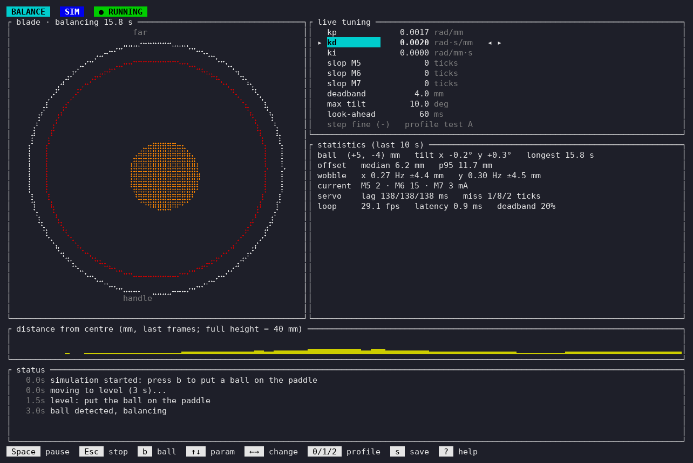
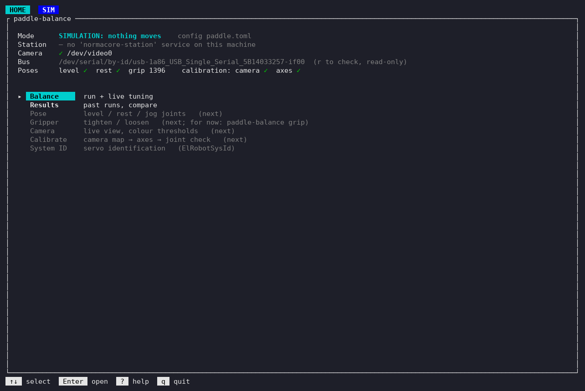
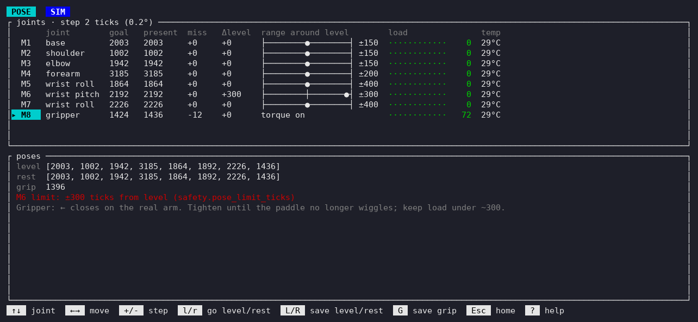
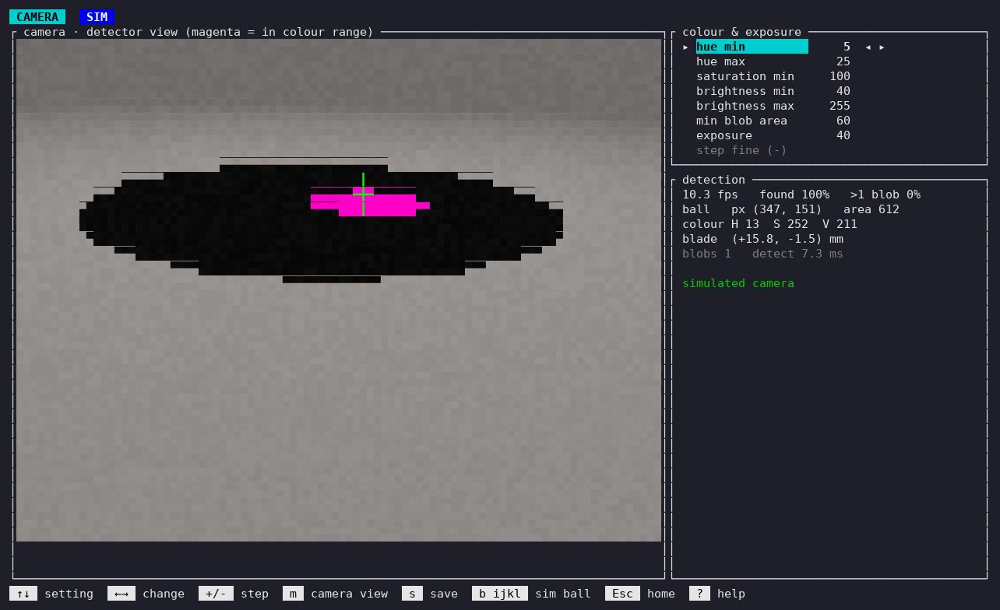
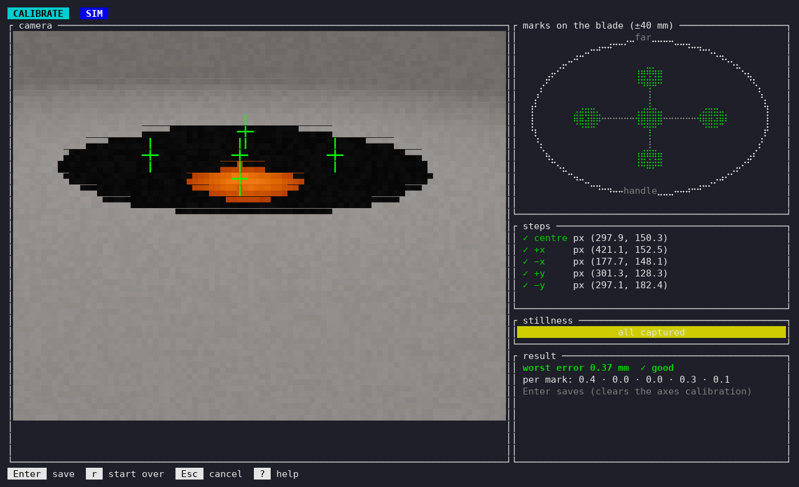
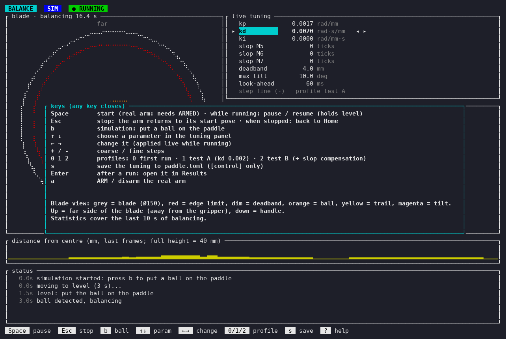
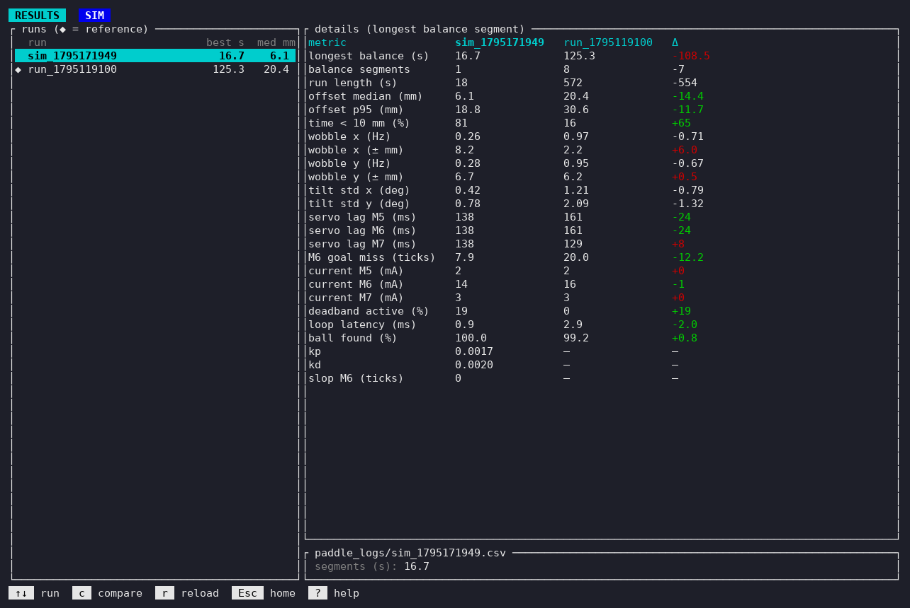

# PingPongSimBot

Balances an orange 40 mm ping-pong ball on a 3D-printed paddle held by the **ElRobot** follower arm. It uses the wrist camera
and a PID on the three wrist joints, and runs on the Raspberry Pi 4 of a NormaCore station.

It is part of [RoboSim #69](https://github.com/spinworks-tech/RoboSim/issues/69) (ping-pong sim2real via PID); the paddle
design is [#73](https://github.com/spinworks-tech/RoboSim/issues/73). The servo identification for the MuJoCo model is in
[ElRobotSysId](https://github.com/robomotic/ElRobotSysId).

**Status (2026-11-19):** the first real run balanced for **125 s**, with a mean wrist current of 3–13 mA. A ~1 Hz limit cycle,
caused by servo lag and slop, keeps the median ball offset at about 20 mm. A fix (more damping and slop compensation) is
implemented and waiting for a test on the robot. See [docs/2026-11-19-first-real-balance.md](docs/2026-11-19-first-real-balance.md).

```
camera (V4L2 YUYV 640x480, ~29 fps) -> HSV threshold + largest blob (pure Rust, half resolution, blade ROI)
  -> homography px -> blade mm -> alpha-beta filter + delay look-ahead
  -> PD(+I) per blade axis with deadband, clamp and slew -> blade tilt
  -> measured axes map (directions) -> weighted damped pseudo-inverse over M5/M6/M7 + null-space pull to level
  -> per-joint slop compensation -> sync write of 3 goal positions on the follower bus (1 Mbps)
```


**Download:** prebuilt Raspberry Pi 4/5 (aarch64) binaries are on the
[Releases](https://github.com/robomotic/PingPongSimBot/releases) page (`paddle-balance-aarch64-linux` + `.sha256`). They need glibc ≥ 2.39 (Debian 13 / Raspberry Pi OS trixie, Ubuntu 24.04+)
and no other libraries. Otherwise, build from source as below.
## Why it talks to the bus directly

Going through the NormaCore station adds about 160 ms of delay and stalls of up to 580 ms
([norma-core#185](https://github.com/norma-core/norma-core/issues/185)). This program owns the follower's serial port, so frame →
goal written takes about 3 ms. The station must be stopped while it runs. Servo torque stays on when the station stops, so the arm
holds its pose.

## Using 3 wrist joints with little effort

The wrist is roll-pitch-roll (M5, M6, M7) and the ball needs only 2 tilt angles. A weighted, damped pseudo-inverse uses the joints
that cost least: M5 moves the most mass, so it has the highest weight. A null-space term pulls the spare direction back to the
level pose.

Other measures that save energy:
- no new goal while the ball is within 4 mm of the centre and nearly still;
- goals that change by under 2 ticks are skipped;
- moderate servo acceleration;
- M1–M4 hold still.

Each run prints the mean wrist current.

## Build (on the Pi)

```bash
curl https://sh.rustup.rs -sSf | sh -s -- -y --profile minimal
sudo apt install protobuf-compiler libclang-dev libudev-dev   # st3215 build.rs, v4l bindgen, serial
cargo build --release            # first build ~5 min on a Pi 4
cargo test                       # 21 unit tests incl. a delayed closed-loop sim
```

`st3215` (the ST3215 packet codec) comes from [norma-core](https://github.com/norma-core/norma-core) as a pinned git dependency.

## Full-screen app

`paddle-balance` with no arguments opens a keyboard-driven app; `paddle-balance tui --sim` runs it on a **simulated arm and
ball**, so nothing moves and no hardware is needed. The simulator is fitted to the real arm's measured servo lag, dead zones and
camera noise.

| Screen | What it does |
|---|---|
| **Balance** | Space starts (rest → level → wait for the ball → balance). It shows the blade from above with the ball, its trail and the tilt arrow; a **live tuning** panel (↑↓ choose, ←→ change, applied at once); live statistics (offset, wobble Hz/mm, servo lag, current, latency, deadband); the distance-from-centre sparkline; and a status log. `0`/`1`/`2` load the first-run / test A / test B gains, `s` saves the tuning, `t` **throws the ball back** (see below), Esc stops and returns to the start pose. |
| **Home** | Station (`x` stop/start, asks first), camera (`c` re-attach after the station), bus (`r` read-only check: servos, voltage, temperature, gripper load), config status. Quitting offers to restart a station the app stopped. |
| **Results** | Every run in `paddle_logs/` and `data/` with its statistics (same as `tools/analyze_run.py`). `c` marks a reference run for a side-by-side comparison with a green/red Δ. |
| **Pose** | All 8 servos live (goal, present, miss, distance from level, load, temperature). ↑↓ joint, ←→ move by 1/5/20 ticks, `l`/`r` go to level/rest (asks first), `L`/`R` save level/rest, `G` save the grip, `t` throw preview without the ball (10/25/50/100 % speed), `T` save the throw end pose. Each joint stays within `safety.pose_limit_ticks` of level, so manual moves stay above the table. The gripper (M8) is in the same table, with automatic back-off above `safety.grip_backoff_load`. Replaces `jog` and `grip`. |
| **Camera** | Live picture (true-colour half blocks) with the detected ball marked. `m` switches to the **detector view** (pixels in the colour range turn magenta). ↑↓ ←→ tune hue / saturation / brightness limits, minimum blob size and exposure **live**; `s` saves them. Shows fps, found %, false blobs, the ball's colour and its blade position. |
| **Calibrate** | Camera-map wizard: highlights the mark to use, **captures automatically** when the ball has been still for ~1 s, fits the map, shows the error per mark, Enter saves. Then `t` (needs ARMED): **axis calibration**, which tilts the wrist 3° per axis, measures where the ball rolls, and shows the directions and the angle between them; Enter saves. (The joint probe is still `probe-joints`.) |
| System ID | in [ElRobotSysId](https://github.com/robomotic/ElRobotSysId) (needs its table safety area first) |



<details>
<summary>More screens: Home, Pose, Camera, Calibrate, help overlay, Results comparison</summary>













</details>

The screenshots come from simulation sessions driven headless by `tools/tui_drive.py` (`p:FILE.png` steps), so they can be
regenerated after UI changes.

Same keys everywhere: ↑↓ select · ←→ adjust · +/- step size · Space main action · Enter confirm · s save · ? help ·
Esc back / q quit · **Ctrl-C emergency stop** (the arm returns to its start pose). Anything that moves the real arm needs the
**ARMED** state (`a`), which switches itself off after 30 s without a key.

Every run log now records the active gains (kp, kd, ki, slop, deadband) on each row, so live tuning shows up in Results.

## Session on the robot

```bash
sudo systemctl stop normacore-station          # frees the follower bus and the camera
# The station's libuvc driver keeps the camera detached from the kernel; give it back:
D=$(grep -l 0c45 /sys/bus/usb/devices/*/idVendor | xargs dirname); echo 0 | sudo tee $D/authorized; echo 1 | sudo tee $D/authorized
cp config/paddle.example.toml paddle.toml       # or start empty: every command fills in its part

B=target/release/paddle-balance
$B scan                      # 8 servos answer? torque on? (no motion)
$B jog                       # teach poses: 'goto level', '<motor> <+/-ticks>', 'save level' / 'save rest'
$B grip                      # full-screen: arrows move the gripper, live load bar, 's' saves
$B vision-test --snapshot f.ppm
$B calib-camera --offset-mm 40   # ball on 5 marks: centre and +/-40 mm on two perpendicular lines
$B calib-axes                # 3 deg tilt per solver axis, measures where the ball rolls
$B probe-joints              # one joint at a time; checks the joint signs against the model
$B run                       # rest -> level -> place ball -> balance; Ctrl-C -> back to the start pose

sudo systemctl start normacore-station
```

All settings and calibrations live in `paddle.toml`. Each run writes `paddle_logs/run_<stamp>.csv`.

## Throw back

A fun mode: while the ball balances, ARM (`a`) and press `t`. After a 2 s countdown (any key cancels) and as soon as
the ball is within 25 mm of the centre, the arm flips the blade from flat to about upright, face toward the camera side,
in one fast move. The ball leaves from the far edge and flies in an arc back over the arm. Then the arm holds, returns
to level and waits for the next ball.

| | |
|---|---|
| Motion | Level → `throw.end` (taught on the Pose screen with `T`; default: the pose taught on 2026-11-20). Mostly wrist pitch M6 (−655 ticks), plus elbow M3 (−179) and M4 (−54). |
| How it runs | The servos run the move themselves: each moving joint gets its goal, a Goal Speed and an Acc, scaled by distance so they all arrive together (0.33 s at full speed). Nothing is streamed during the move. The previous speed/acc are always restored. |
| Safety | Needs ARMED; starts from level only; the end pose must be inside `throw.limit_ticks` of level; a joint stalled above `throw.abort_load` or a move far slower than planned stops the arm where it is. |
| Simulation | `tools/throw_sim.py` (MuJoCo, URDF + 68 g paddle + 2.7 g ball): at full speed the ball leaves at ~2.0 m/s, 47° up, peaks ~55 cm above the table and lands ~50 cm on the camera side; peak torque 1.3 N m (stall 2.94). **Below ~75 % speed the ball hits the camera or rolls into the jaws**: run slow previews without the ball. |
| Joint angles | The sim uses the station viewer's mapping (calibrated range → URDF limits), checked against the real arm at level. The controller's own `zero = 2048, sign = −1` is only right for small relative moves. |

Order for the first real tries: Pose → `l` (level) → `t` `1` (10 %, no ball) → `t` `2` → `t` `3` → `t` `4`, watching the
paddle in the gripper; then Balance with the ball and `t` at 100 %.

```bash
python tools/throw_sim.py --throw                       # 25/50/75/100 % speed: release, apex, landing, torques
python tools/throw_sim.py --throw --speed 1 --video throw.mp4 --slow 8   # 8x slow motion
```

## Calibrations: what they are and when to redo them

The camera sits on the wrist and sees the blade at a slant, so a pixel doesn't map to a fixed distance on the blade:
about 3.0 px/mm sideways but only about 0.66 px/mm near/far. Two calibrations turn what the camera sees into tilt commands.

| Calibration | What it measures | How (Calibrate screen) | Stored as | Redo when |
|---|---|---|---|---|
| **Camera map** | The pixel → blade-millimetre conversion (a homography). The controller needs the ball's position in mm from the centre, not in pixels. | With the paddle at level, draw 5 marks on the blade: the centre and ±40 mm (or ±50) on two perpendicular lines. Put the ball on each mark. It is captured automatically once it has been still for about 1 s. The screen fits the map and shows the error at each mark (under 3 mm is good). Enter saves. | `camera.homography` | the camera moves on the wrist, the paddle shifts or rotates in the gripper, or a new paddle |
| **Axes** | Which way the ball rolls when the solver tilts each blade axis. | `t` (needs ARMED): the wrist tilts 3° per axis and the screen measures where the ball rolls. Enter saves. | `camera.axes` | after a new camera map, or if the ball runs away instead of being corrected |

The **level pose** (Pose screen, `L`) is not a camera calibration but just as important: the controller treats it as
"flat". If the ball keeps settling off centre on the same side in every run, level is probably off by about 1°. Fix the
pose and save it with `L`, or use a small `ki`.

## Tools

| | |
|---|---|
| `tools/tui_drive.py` | run the full-screen app headless in a pseudo-terminal, send keys, print the screen or save PNG screenshots (needs `pyte`, `Pillow`) |
| `tools/analyze_run.py <csv>` | balance segments, ball offset, limit-cycle frequency and amplitude, servo lag, latency, deadband use |
| `tools/tune_sim.py` | 2-axis sim fitted to the real run (delay, servo lag, slop, noise); grid-searches gains |
| `tools/station_read_positions.py` | read all servo positions through a running station (read-only), e.g. after teleop |
| `data/run_1795119100.csv` | the first real run (125 s balance) |

## Safety

- `run` refuses to start if any joint is more than 150 ticks from the saved rest pose.
- M5–M7 are clamped to ±250 ticks around level, and the tilt to ±10° (slew 60°/s).
- Ball lost for 0.5 s, or more than 65 mm out → back to level and wait for the ball.
- No camera frame for 1 s, or 3 failed servo reads in a row → stop and return.
- Ctrl-C, and any error, always ends with a smooth move back to the start pose.
- M8 (gripper) is written only by `grip`, and at startup to re-apply the saved grip (only if within 60 ticks of where it is).
  It never moves while balancing.

## Layout

```
src/bus.rs         ST3215 bus over tokio-serial (reads, sync writes, hold-in-place, grip)
src/config.rs      paddle.toml schema and defaults
src/vision.rs      YUYV -> HSV -> blob detector, V4L2 capture thread, PPM snapshots
src/estimator.rs   homography (DLT), alpha-beta filter
src/kinematics.rs  orientation FK from the URDF axes, weighted damped pseudo-inverse with null space
src/control.rs     ball PID, axes map, slop compensation, acceleration fit, min-jerk
src/arm.rs         the arm: bus + last goals, min-jerk moves
src/balance.rs     balancing engine: Balancer (frame -> action), Plant trait (RealPlant), run_loop, CSV run log
src/sim.rs         SimPlant: simulated servos (delay, lag, dead zone) + ball + camera, fitted to the real run
src/analysis.rs    run statistics (Rust port of analyze_run.py) and live-stat helpers
src/app.rs         line-based subcommands (scan, jog, calib-*, probe-joints, run)
src/tui/           full-screen app (ratatui): mod.rs (shell, keys, help, Home), system.rs (station/camera/bus),
                   balance.rs, results.rs, pose.rs + device.rs (arm task), camera.rs, calibrate.rs, camview.rs
src/grip_tui.rs    gripper adjuster (crossterm; moves into the app next)
```

## License

Apache License 2.0, see [LICENSE](LICENSE).
