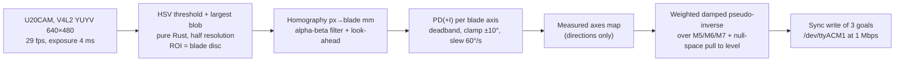

## Progress update (2026-11-19): first closed-loop balance on the real arm, 125 s

The PID balances the ball on the real follower. It runs from the Pi as a standalone Rust program that drives the follower bus
directly, so it avoids the station's delay and the stalls in `norma-core/norma-core#185`. The longest run kept the ball on the
blade for **125.3 s**, with a mean wrist current of **3 / 13 / 3 mA** (M5 / M6 / M7).

### Architecture (Phase 2 ahead of Phase 1)

| Part | Choice |
|---|---|
| Code | [robomotic/PingPongSimBot](https://github.com/robomotic/PingPongSimBot) (first written as `paddle-balance-rs` inside a norma-core tree). Reuses `st3215::protocol` (packets, register map, sync write) |
| Bus | Owns the follower bus directly. The station is stopped while it runs (`systemctl stop normacore-station`); servo torque stays on when the station stops |
| Vision | No OpenCV: V4L2 (`v4l` crate) and hand-written HSV (OpenCV ranges, H 5–25, S ≥ 100, V ≥ 40). 9 ms per frame on the Pi 4 |
| Joints | **All three wrist joints, M5 + M6 + M7.** The PD gives a 2-axis blade tilt. A weighted, damped pseudo-inverse spreads it over the 3 joints (cost weights 3 / 1.5 / 1, so M5, which moves the most mass, is used least), and a null-space term pulls the spare direction back to the level pose. The damping handles the near-alignment of M5 and M7 |
| Kinematics | Orientation-only FK from the URDF axes (all joints have rpy = 0); tick → rad = −(tick − 2048)·2π/4096 |
| Energy | No new goal while the ball is within 4 mm of the centre and slower than 10 mm/s; goal changes under 2 ticks are skipped; moderate wrist `Acc` (100); M1–M4 hold still |
| Safety | Wrist ±250 ticks around level; tilt ±10°. Ball lost for 0.5 s or more than 65 mm out → back to level and wait. No frame for 1 s, or 3 failed reads in a row → stop. Ctrl-C → smooth return to the start pose |

Subcommands: `scan`, `jog`, `grip` (full-screen terminal UI), `vision-test`, `calib-camera`, `calib-axes`, `probe-joints`, `run`.
Every value lives in `paddle.toml` on the Pi.

### Facts measured on the real arm

| Item | Value | Source |
|---|---|---|
| Follower bus | CH343 serial `5B14033257` = `/dev/ttyACM1` (used via `/dev/serial/by-id`); leader `5B14112350` = `ttyACM0` | `paddle-balance scan`, station `st3215/inference` |
| **Level pose** (face-to-camera layout, paddle flat), ticks M1–M8 | `2003 1002 1942 3185 1864 1892 2226 1440` | Set by Paolo through teleop, read from the station, checked twice |
| Web UI pitfall | The 4-digit zero-padded numbers in the station UI are the calibration **Range Min**, not positions (M1 1087, M2 1004, M3 935, M5 141, M6 1040, M7 134, M8 1237) | `MotorDataTable.tsx` |
| Gripper | M8 torque was found **OFF** (paddle loose). New grip: goal 1396 with the jaws on the handle at 1436, so **40 ticks of squeeze, load 17%, 117 mA, 30 °C** | `grip` command |
| Camera after stopping the station | The station's libuvc driver detaches the kernel `uvcvideo` driver and doesn't give it back; `/dev/video0` returns after re-enumerating the USB device (`authorized` 0 → 1) | Pi, 2026-11-18/19 |
| Camera map | 5-point homography (centre, ±40 mm on two lines). Resolution: **≈3.0 px/mm sideways, ≈0.66 px/mm near/far** | `calib-camera` |
| Pi build dependencies | Rust (rustup), `protobuf-compiler`, `libclang-dev`, `libudev-dev`; first release build about 5 min | Pi 4 |

### Wrist response (single-joint and axis probes, 3° steps)

| Probe | Ball direction (blade frame) | Fraction of the ideal 0.6·g·θ |
|---|---|---|
| `calib-axes` u, paddle loose | 157° | 0.48 |
| `calib-axes` v, paddle loose | 84° | 0.24 |
| `calib-axes` u, **gripped** | 172° | 0.36 |
| `calib-axes` v, **gripped** | 95° | **1.01** |
| `probe-joints` M5 (35 ticks) | −163° | 0.50 |
| `probe-joints` M6 | 77° | 0.23 |
| `probe-joints` M7 | 176° | 0.63 |

- **Joint signs are consistent with the URDF.** M5 and M7 push the ball the same way (model 5°, measured 21° apart). A sign error would show about 180°.
- **Directions repeat well; magnitudes don't** (0.23–1.01). The likely cause is servo slop and lag on small steps. So the controller uses only the measured **axis directions** (unit-length columns), and `kp`/`kd` set the gain.

### First real run (`run_1795119100.csv`, 572 s, 8 balance segments)

| Metric | Value |
|---|---|
| Longest balance | **125.3 s** (others: 36.6, 20.5, 16.0, 15.2, 11.7, 10.0, 2.3 s) |
| Ball tracked during balance | 98.3% of frames, 29.2 fps, no frame gap over 37 ms |
| Ball distance from centre (125 s segment) | median 20 mm, p95 31 mm; under 10 mm only 16% of the time |
| Oscillation | steady **~1 Hz limit cycle**: amplitude 7 mm near/far, 2 mm sideways |
| Tilt used | std 1.2° / 2.1°, max 4.2° / 8.4° (sideways / near-far) |
| Our loop latency (frame → goal written) | **2.9 ms median**, 3.2 ms p99 |
| **Servo response** | present trails goal by **4–5 frames (~150 ms)** on M5–M7; M6 misses its goal by 20 ticks on average |
| Mean wrist current | M5 3 mA, M6 13 mA, M7 3 mA |

**The delay budget is now measured, not estimated.** The software loop adds about 3 ms and the station stalls are gone.
**The servos are the main delay (about 150 ms) and the main nonlinearity (about 1.7° of slop on M6)**, and together they explain
the 1 Hz limit cycle. A 2-axis sim fitted to this run (3 frames of delay, 0.03 rad of slop, a first-order servo, measured
detection noise) reproduces the real 22 mm median with the original gains and predicts:

| Change | Sim median offset |
|---|---|
| Original (`kp` 0.0017, `kd` 0.0008, look-ahead 60 ms) | 22 mm (matches the real run) |
| `kd` → 0.0020 | ~9 mm |
| `kd` 0.0020 + per-joint slop compensation | ~4.5 mm |
| Longer look-ahead (120–250 ms) | no gain |

`kd = 0.002` is now the default. Slop compensation is implemented (`control.backlash_ticks`, proposed `[4, 16, 6]` for
M5–M7) and is off until tested on the arm.

### Sim2real2sim: what can be identified

| Group | Parameters (MuJoCo) | Status / source |
|---|---|---|
| Servo | position `kp`, `forcerange`, first-order lag (`dyntype="filter"`) + control delay, deadband/slop, `frictionloss`, `damping`, `armature` | Lag (~150 ms) and M6 slop (~20 ticks) measured from the run log. **Per-joint system ID (steps, chirps, reversals at full bus rate) still to do**; `~/elrobot_motions` E1–E3 may already cover part of it |
| Arm | tick → URDF angle (sign and zero), link masses and inertias | Signs checked (`probe-joints`); masses from the URDF |
| Paddle | mass, inertia | **Printed v2 weight still needed** (also open in #73); inertia from the CadQuery model |
| Grasp | grip force, jaw-pad friction | Grip: 40 ticks of squeeze at 17% load. Pad friction: still has no source (sim recipe 0.12) |
| Ball / blade | ball 40 mm, 2.7 g, thin shell (I = ⅔ m r²); rolling and sliding friction with `condim="6"` | Fit by **replaying the logged present ticks in MuJoCo** and matching the logged ball path |
| Camera | intrinsics, extrinsics, latency, detection noise | **Done:** checkerboard intrinsics and #73 registration (lens at X −30.3, Y −2.52, Z 28.0 mm, 25°). Light-to-frame latency (LED test) still open |

### Next

1. Real arm: test A (`kd` 0.002), then test B (+ slop compensation); report median offset, limit-cycle size and current.
2. If the near/far axis still wobbles more: separate PD gains per blade axis (near/far has a third of the camera resolution).
3. `sysid` subcommand (Paolo, later): per-joint steps, chirps and reversals logged at full bus rate.
4. MuJoCo (Phase 1): scene with the unmodified `elrobot_game.xml` + paddle + ball; servo model from the system ID; check it by
   replaying the logged runs; then the same controller in sim. Check what MuJoCo 4.1 offers natively (actuator delay or backlash)
   before modelling those in the wrapper.
5. Code moved to robomotic/PingPongSimBot; the system ID tool is in robomotic/ElRobotSysId.
